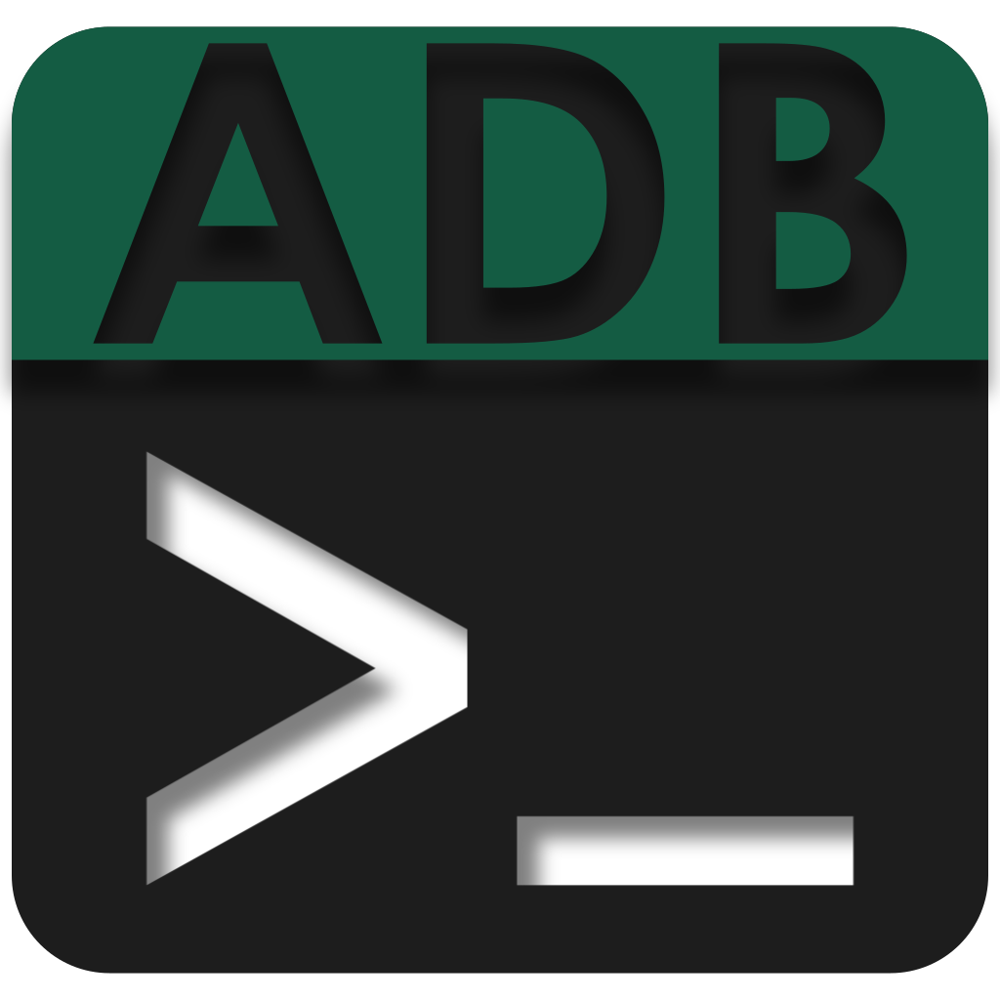

# ADB Tools Pro

**La boîte à outils gratuite du technicien Android.**
Diagnostiquer, contrôler et dépanner un terminal Android — smartphone, tablette ou terminal durci de logistique — depuis un PC Windows, sans taper une seule ligne de commande.

*Free Windows toolbox for Android support technicians: device dashboard, screen mirroring, app and file management, guided hardware diagnostics, Wi-Fi analysis and Word reports — all on top of ADB, no command line needed.*

Windows 10 / 11 · programme portable, rien à installer dans Windows

---

## À quoi ça sert ?

Un terminal revient en SAV : « l'écran ne réagit plus », « le Wi-Fi décroche dans l'entrepôt », « une appli plante au démarrage ». ADB Tools aide à trouver **ce qui ne va pas** — matériel, réseau ou logiciel — et à le **prouver** avec un rapport Word propre, à remettre au client.

Il s'adresse aux techniciens SAV, intégrateurs, services informatiques et logistiques, et à tous ceux qui gèrent des terminaux Android, **quelle que soit la marque** (Zebra, Honeywell, Datalogic, Samsung…).

## Ce que fait ADB Tools

### 📱 Tableau de bord du terminal
- Batterie, mémoire, processeur et stockage en jauges colorées (vert, jaune, rouge selon l'état).
- Modèle, version d'Android, build, numéro de série, durée de fonctionnement, écran.
- Plusieurs terminaux branchés : on passe de l'un à l'autre, et une commande peut être **lancée sur tous à la fois**.

### 📺 Mirroring
- **Affichage et contrôle de l'écran** du terminal sur le PC (scrcpy), même sans toucher le terminal.
- Capture d'écran et **enregistrement vidéo**, avec un filigrane (société, modèle, date) pour les preuves SAV.

### 📦 Applications et fichiers
- Installer des APK par glisser-déposer (y compris les applications « Split-APK »), lancer, vider le cache, désinstaller.
- Explorateur de fichiers : envoyer et récupérer des fichiers du terminal.

### 🔧 Diagnostics SAV
- **Check-up automatique** : Wi-Fi, ping, batterie, stockage, capteurs, températures.
- **Tests manuels guidés** : boutons physiques, dalle tactile (grille à remplir), scanner, écran (pixels morts, brûlure).
- Laboratoire matériel en direct : chaque appui de bouton et chaque touche de l'écran s'affichent sur le PC.
- **Rapport Word** à votre en-tête et votre logo, ou export JSON.

### 📡 Analyse Wi-Fi
- Suivi en direct de la latence, des pertes de paquets et du signal (graphiques).
- Détection des changements de point d'accès (roaming) et des déconnexions.
- Rapport Word avec les graphiques, pour montrer au client ce qui s'est passé.

### ⚡ Outils avancés
- Simulation des boutons physiques, luminosité, densité d'affichage, résolution, volume.
- Mise à jour de l'OS par sideload (.zip), extraction de l'écran en XML (UI Automator).
- Bibliothèque de commandes ADB prêtes à l'emploi, à compléter avec les vôtres.
- Logs en direct (logcat) avec filtres, et génération du bugreport complet.

### ⚙️ Pratique au quotidien
- Thème clair, sombre ou **comme Windows**.
- Connexion **sans câble** (Wi-Fi, Android 10 et moins comme Android 11 et plus).
- **Modèles de rapport personnalisables** : modifiez le modèle fourni ou importez le vôtre, avec des balises comme `{{SOCIETE}}` ou `{{NUMERO_SERIE}}`.
- **Historique par numéro de série** : chaque rapport est rangé dans l'historique du terminal, consultable et partageable avec l'équipe (dossier réseau).
- **Profil d'équipe** : un seul fichier `.adbprofil` pour configurer tous les postes pareil (en-tête des rapports, logo, modèles, bibliothèque de commandes, dossier des mises à jour).
- **Mises à jour** depuis GitHub ou depuis un dossier de diffusion de l'équipe, vérifiées (SHA-256) et installées en un clic.
- Accueil et **visite guidée** au premier lancement.
- **Tout reste sur le PC** : aucune donnée n'est envoyée sur Internet.

## Démarrer

1. Téléchargez `ADBToolsPro-x.y.z.zip` depuis la [page des versions](../../releases/latest) et décompressez-le où vous voulez (aucune installation).
2. Lancez `ADBToolsNew.exe`. Au premier lancement, ADB Tools propose de télécharger **ADB / Fastboot** (Google) et **scrcpy** (environ 20 Mo) depuis leurs sites officiels, dans le dossier `Tools` à côté du programme.
3. Sur le terminal : activez les **options développeur** puis le **débogage USB**, branchez-le et acceptez la demande d'autorisation.

**Prérequis :** Windows 10 ou 11, .NET Framework 4.7.2 ou plus récent (déjà présent sur les Windows à jour).
FFmpeg (environ 100 Mo) n'est proposé que si vous utilisez le filigrane des vidéos.

## Compiler depuis les sources

- **Visual Studio 2022 ou plus récent**, avec la charge de travail « Développement .NET Desktop » et le pack de ciblage .NET Framework 4.7.2.
- Ouvrez `ADBToolsNew.slnx`, restaurez les packages NuGet, puis lancez la compilation.
- Les outils tiers ne sont pas dans le dépôt : le programme les télécharge lui-même au premier lancement.

## Confidentialité

ADB Tools fonctionne entièrement sur le PC : **aucun rapport, aucune capture ni aucune donnée de terminal n'est envoyé sur Internet**, et il n'y a ni compte, ni publicité, ni mesure d'audience.
Les seules connexions servent à télécharger et vérifier les **outils tiers** depuis leurs sources officielles : `dl.google.com` (ADB / Fastboot), `api.github.com` et `github.com` (scrcpy), `www.gyan.dev` (FFmpeg). La vérification des mises à jour a lieu au plus une fois par jour, sans aucune information personnelle.

## Une question, un souci ?

Ouvrez un **ticket** (« issue ») sur ce dépôt : un problème, un terminal à prendre en charge ou une idée.

## Soutenir

ADB Tools est gratuit et le restera, sans publicité. S'il vous fait gagner du temps, un don libre aide à le faire évoluer : [paypal.me/MrKanard](https://www.paypal.me/MrKanard).

## Licence

Logiciel **libre et gratuit**, créé par **Mr.Kanard**, sous licence [GNU GPL v3](LICENSE) : chacun peut l'utiliser, le partager et l'améliorer, à condition que ses versions restent libres. Fourni sans aucune garantie.
Composants tiers : voir [Docs/THIRD_PARTY_NOTICES.txt](Docs/THIRD_PARTY_NOTICES.txt).
